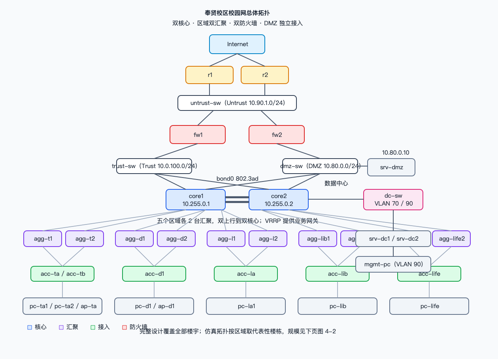
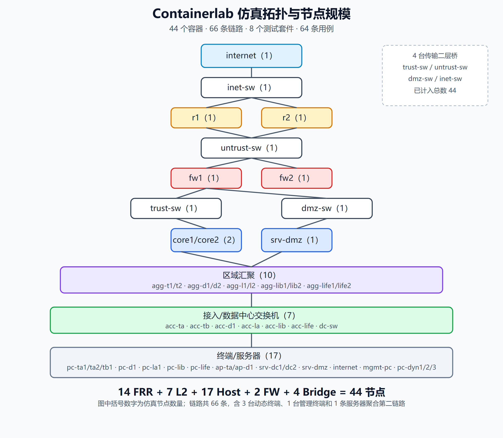
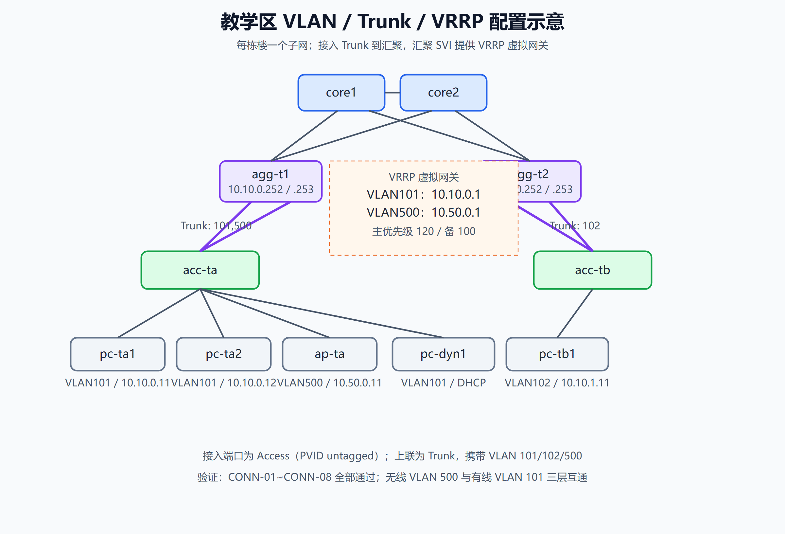
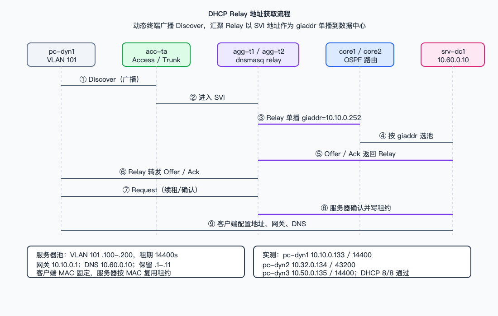
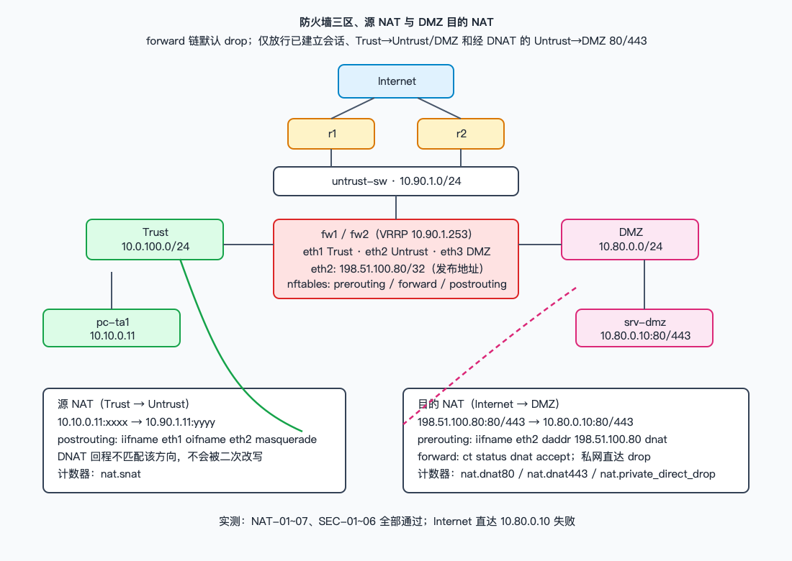
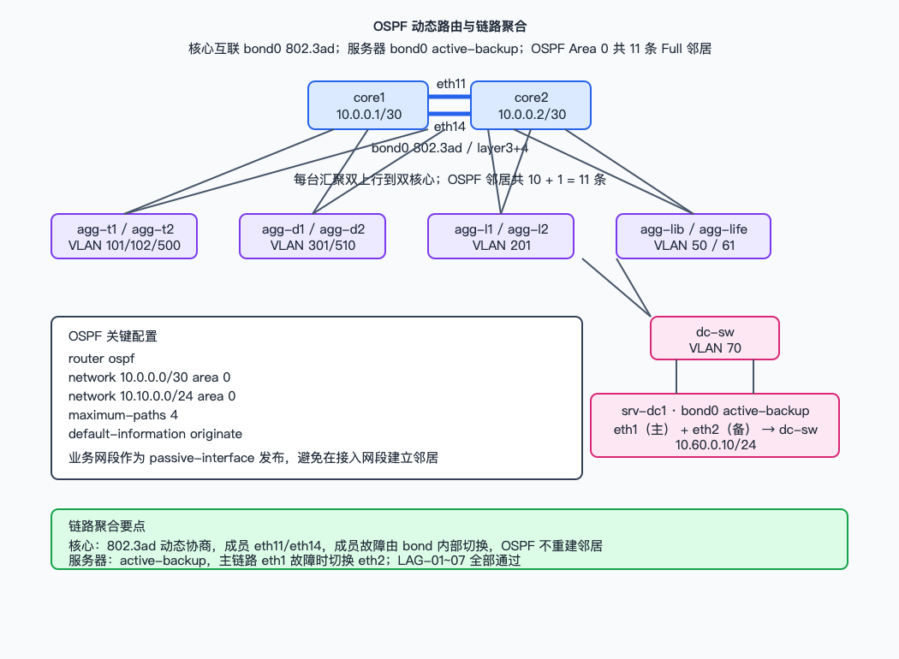
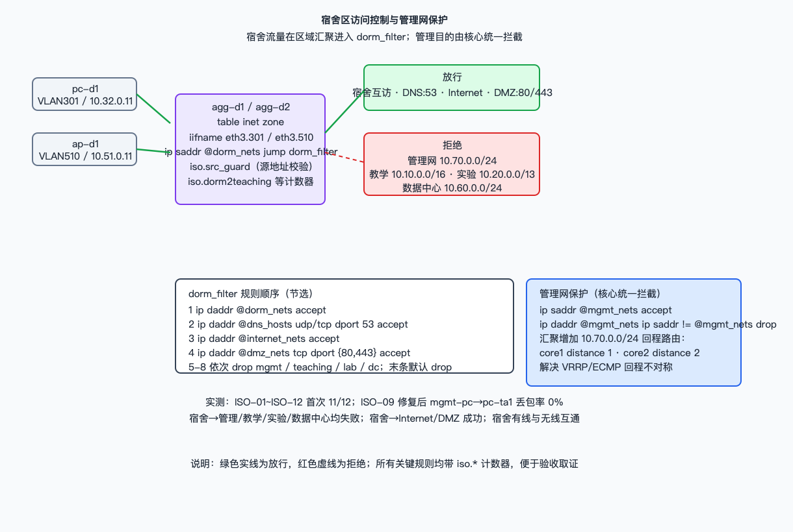

# 《网络工程实践》课程设计报告

班　　级：__________　　学　号：__________　　姓　名：__________

指导教师：张海腾、丁炜超

信息科学与工程学院

2026 学年第 1 学期

## 组别与任务分工

| 组别 | 姓名 | 学号 | 任务分工 |
| --- | --- | --- | --- |
| 第 __ 组 | ________ | ________ | 整体报告撰写、格式排版、图表整理与参考文献 |
| | ________ | ________ | 研究背景、目的与意义、IP 地址分配与 VLAN 划分 |
| | ________ | ________ | 校园网需求分析与总结 |
| | ________ | ________ | 校园网络建设综合设计 |
| | ________ | ________ | 路由器与交换机配置实验 |
| | ________ | ________ | 网络拓扑绘制、设备配置、系统测试、设备清单与报价 |

# 奉贤校区校园网设计与实现方案

> 排版说明：提交 Word 版时按附件 3 格式要求设置——摘要、关键词标签用黑体小四，正文用宋体小四并首行缩进 2 字符；一级标题居中、黑体小二，二级标题宋体四号，三级标题宋体四号；参考文献另起一页、悬挂缩进；目录使用 Word 自动目录，页码以排版后为准。

## 摘要

随着教育信息化的深入发展，校园网已成为高校教学、科研、管理和生活服务的基础设施。本报告以华东理工大学奉贤校区校园网为对象，依据任务书要求完成需求分析、总体架构、地址与 VLAN 规划、路由与冗余、安全分区、设备选型与仿真验证。方案采用核心—汇聚—接入三层结构，双核心与区域双汇聚提供冗余，主干 10Gb、汇聚到楼层 1Gb、宿舍房间 100Mb；内网运行 OSPF，网关采用 VRRP 热备，出口双防火墙划分 Trust/Untrust/DMZ 三区，并实现源 NAT 与 DMZ 目的 NAT。仿真工程以 Containerlab 为平台，使用 FRRouting、keepalived、Alpine VLAN bridge 与 nftables，由单一事实源生成 44 个容器、66 条链路。本次实践补齐 DHCP 与 Relay、宿舍区访问控制、DMZ 发布、链路聚合和断言式测试框架；首次全量 64 条用例通过 61 条，3 条失败已定位修复，修复后关键路径复核通过。

**关键词：** 校园网，三层交换，VLAN，OSPF，VRRP，DHCP Relay

## 目录

1. 研究背景
2. 研究目的与意义
3. 奉贤校区校园网需求分析
4. 网络拓扑与 IP 划分
5. 校园网络建设综合设计
6. 设备清单与报价
7. 路由器与交换机配置
8. 总结
参考文献

## 1 研究背景

### 1.1 校园网络在高校信息化中的基础性作用

进入 21 世纪，信息技术深刻改变了高校的教学组织方式、科研协作方式与行政管理方式。校园网不再只是师生访问互联网的通道，而是承载教务、财务、图书文献、办公自动化、在线课程、视频会议和校园一卡通等核心业务的基础平台。网络一旦中断，教学与管理工作会直接受到影响，因此校园网必须同时具备高性能、高可靠和可管理三项基本能力。

### 1.2 高校对高质量校园网络的现实需求

随着在校生规模扩大、移动终端普及和智慧校园应用深入，校园网面临三方面压力：一是接入终端数量快速增长，宿舍与教学区出现高密度并发；二是多媒体教学、在线考试和科研数据传输对带宽与时延提出更高要求；三是网络安全边界更加复杂，宿舍、实验区、数据中心和对外服务系统需要不同的访问权限。传统扁平网络难以同时满足这些要求，需要采用分层、模块化和安全分区的设计。

### 1.3 校园网络规划设计的基本考量

校园网规划需要综合考虑楼宇分布、信息点规模、业务流向、冗余等级和投资约束。设计时应先确定区域边界和地址规划，再确定核心、汇聚、接入三级架构；在关键节点采用双机、双上行和链路聚合；在出口统一收口，按 Trust、Untrust、DMZ 划分安全域；同时保留地址、VLAN 和路由的扩展空间，避免新增楼宇时改动全局结构。

### 1.4 本次设计实践的目的与意义

本次实践以奉贤校区为对象，目标是把课堂中的 VLAN、Trunk、三层交换、OSPF、VRRP、DHCP、NAT、ACL 等知识组织成一套完整的校园网方案，并通过 Containerlab 仿真验证其可运行性。相比只画拓扑图，本次实践强调“设计文档、可执行工程、验收测试”三件套一致：地址与设备表能对应到配置，配置能对应到测试用例，测试结果能对应到报告结论。这种训练有助于理解网络工程从需求到验收的完整过程。

## 2 研究目的与意义

### 2.1 设计目标

本方案的设计目标包括：

1. 建成覆盖教学区、宿舍区、实验区、图书馆、生活区和数据中心的校园网；
2. 核心与汇聚采用冗余结构，单台核心、单台汇聚、单条上联或单台防火墙故障时业务不中断；
3. 每栋楼一个子网，通过区域汇聚与核心路由，实现教学、宿舍、实验三个区域“自成一体”；
4. 内网使用 OSPF 动态路由，出口使用静态路由与默认路由，路由职责清晰；
5. 通过 VRRP 提供网关热备，通过 DHCP 与 Relay 提供集中地址服务；
6. 通过防火墙三区、源 NAT、DMZ 目的 NAT 和宿舍访问控制实现安全边界；
7. 通过链路聚合提升关键链路带宽与可靠性；
8. 建立可重复执行的验收测试，避免“配置成功但业务不通”。

### 2.2 实践意义

本实践的意义在于把分散的网络技术点放进真实工程约束中。例如，VRRP 不只是配置一个虚拟 IP，还要考虑主备优先级、回程路径和 ACL 的非对称问题；DHCP 不只是开一个地址池，还要考虑 Relay 的 `giaddr`、租期、保留地址和服务器可达性；NAT 不只是写 masquerade，还要区分源 NAT 与目的 NAT 的回程。通过这些问题的定位与修复，能够形成可迁移的排障思路。

## 3 奉贤校区校园网需求分析

### 3.1 项目背景

奉贤校区承担大量本科生教学与科研任务，校园功能分区明确，主要包括教学区、实验区、宿舍区、图书馆、生活区和信息大楼/数据中心。任务书要求以网络中心为核心，建设连接各区域、梅陇校区和 Internet 的校园网；主干 10Gb，汇聚到楼层 1Gb，宿舍房间 100Mb，其他大楼房间 1Gb；教学、宿舍、实验三个区域各自成一体，每栋楼一个子网，通过路由与总汇聚连接。

### 3.2 工程项目概览

按设计方案口径，校区楼宇与信息点规模如下：

| 区域 | 楼宇 | 栋数 | 层数 | 每层布置 | 说明 |
| --- | --- | --- | --- | --- | --- |
| 教学区 | 教学楼 A–E | 5 | 4 | 10 间教室 × 2 信息点 | 教学 A 楼为教学区汇聚点 |
| 实验区 | 实验大楼 A–H | 8 | 8 | 16 间实验室 × 4 信息点 | 实验 A 楼为实验区汇聚点 |
| 宿舍区 | 学生公寓 1–28 | 28 | 6 | 24 间宿舍 × 2 信息点 | 第 1 宿舍为宿舍区汇聚点 |
| 图书馆 | 图书馆 | 1 | 10 | 1–4F 每层 8 间 × 4 点；5F 电子阅览室 200 点 | 6–10F 为文献存储 |
| 生活区 | 食堂 1–2、体育馆 | 3 | — | 食堂与体育馆信息点 | 生活区汇聚 |
| 网络中心/数据中心 | 信息大楼 | 1 | 8 | 计算机实验中心、数据中心 | 独立接入核心 |

信息点合计约 14,514 个，按“满足 5–10 年、留 30% 余量”的原则选型。仿真工程不部署全部楼宇，而是按区域各取代表性楼宇，形成 44 个容器、66 条链路的可运行拓扑；完整楼宇规模由地址表与配置模板覆盖。

### 3.3 各区域功能需求分析

| 区域 | 主要业务 | 网络需求 | 安全需求 |
| --- | --- | --- | --- |
| 教学区 | 多媒体教学、在线课程、教师办公 | 高并发、低时延、无线覆盖 | 可访问 Internet 与教学资源，不能访问管理网 |
| 宿舍区 | 上网、娱乐、智能寝室 | 房间 100Mb、晚高峰并发高 | 禁止访问管理网、教学区、实验区和数据中心，仅放行 Internet 与 DMZ 服务 |
| 实验区 | 科研数据、实验设备、教学服务器 | 千兆到房间、稳定带宽 | 与宿舍、管理网隔离，按需访问数据中心 |
| 图书馆 | 图书检索、电子阅览 | 电子阅览室高密度接入 | 可访问图书馆应用与 Internet |
| 生活区 | 食堂、体育馆、监控与赛事直播 | 无线覆盖、视频流量 | 按公共区域策略接入 |
| 数据中心 | 教务、OA、图书馆系统、DHCP、AC | 服务器双网卡、双电源、高可用 | 只经防火墙对外，管理网独立保护 |
| DMZ | Web、邮件、DNS 对外服务 | 公网发布、端口映射 | 仅开放 80/443，禁止直达内网 |

### 3.4 网络建设要求

1. 核心层双机、汇聚层双机、出口防火墙双机，关键链路采用聚合或双上行；
2. 每栋楼一个 VLAN 与一个 /24 子网，区域汇聚作为本区域网关和路由边界；
3. 内网运行 OSPF Area 0，核心向汇聚注入默认路由，出口使用静态路由；
4. 网关采用 VRRP，主节点优先级高于备节点，故障后自动接管；
5. 部署 DHCP 服务器与区域 Relay，按 VLAN 分池，宿舍、教学、实验租期区分；
6. 出口划分 Trust/Untrust/DMZ，实现源 NAT、DMZ 目的 NAT 和默认拒绝；
7. 宿舍区不能访问受保护的管理网络，策略需可计数、可验证；
8. 关键链路采用链路聚合，核心互联使用 802.3ad，服务器使用主备聚合；
9. 地址、VLAN、设备配置和测试结果可复现、可追溯。

### 3.5 主要信息与应用系统设备需求分析

| 系统 | 数量 | 部署位置 | 说明 |
| --- | --- | --- | --- |
| DNS（内外分设） | 4 | 数据中心 2 + DMZ 2 | 内外网域名解析 |
| DHCP | 2 | 数据中心 | 集中地址服务，汇聚运行 Relay |
| WWW 门户/邮件 | 2 + 2 | DMZ | 对外发布，仅开放 80/443 |
| 教务管理/OA | 2 + 1 | 数据中心 | 核心业务系统 |
| 图书馆应用 | 1 | 数据中心 | 图书检索与借阅 |
| RADIUS/AAA | 2 | 数据中心/DMZ | 认证与计费 |
| AC | 2 | 数据中心 | 无线集中管理 |
| NMS 网管 | 1 | 数据中心 | 设备状态与流量监控 |
| 数据库/备份 | 2 + 1 | 数据中心 | 业务数据与备份 |
| 出口防火墙 | 2 | 网络中心 | 三区策略、NAT、VPN |
| 出口路由器 | 2 | 网络中心 | 连接 Internet 与梅陇校区 |

## 4 网络拓扑与 IP 划分

### 4.1 网络拓扑结构

完整设计采用“双核心 + 区域双汇聚 + 接入交换机”的三层结构。核心 `core1/core2` 通过两条链路聚合成 `bond0`，各区域汇聚双上行到双核心，接入交换机通过 Trunk 上联汇聚，终端通过 Access 端口接入。出口方向由 `fw1/fw2` 双防火墙连接 `r1/r2` 双出口路由器，再连接 Internet；DMZ 服务器挂在独立 DMZ 交换机上。校园网总体拓扑如图 4-1 所示。

```text
                        Internet
                           |
                    r1 ---------- r2
                         |     |
                    untrust-sw
                         |     |
                      fw1 ---- fw2
                         |     |
              trust-sw        dmz-sw
                 |                 |
        core1 ===== core2       srv-dmz
          |   \   /   |
      agg-t  agg-d  agg-l  agg-lib  agg-life
        |      |      |       |        |
      acc-*  acc-*  acc-*   acc-*    acc-*
        |      |      |       |        |
      终端   终端   终端    终端     终端
```



**图 4-1 校园网总体拓扑**

可运行仿真拓扑由 `campus-lab/gen.py` 生成，当前为 **44 个容器、66 条链路**：14 台 FRR 路由节点、7 台二层交换机、17 台终端/服务器、2 台防火墙、4 台传输二层桥。新增 VLAN 90 管理网与 `mgmt-pc`，新增 3 台 DHCP 动态终端，服务器 `srv-dc1` 增加第二条接入链路做 active-backup 聚合。仿真拓扑与节点规模如图 4-2 所示。

<!-- facts:begin -->
nodes=44
links=66
vlans=50,61,70,80,101,102,201,301,500,510
mgmt_vlan=90
dhcp_pools=8
nat_publish=198.51.100.80:80,198.51.100.80:443
lags=core-lag0,dc-srv-lag0
<!-- facts:end -->



**图 4-2 Containerlab 仿真拓扑与节点规模**

### 4.2 IP 地址分配与 VLAN 划分

地址采用“地址即含义”的规则：`10.A.B.0/24` 中 A 表示区域、B 表示楼栋序号，一栋楼一个 /24；核心与汇聚之间使用 `/30` 互联，环回使用 `10.255.0.0/16` 的 `/32`；管理网使用 VLAN 90、`10.70.0.0/24`。仿真环境只保留代表性楼栋，但 VLAN 编号规则与完整设计一致。

#### 4.2.1 完整地址规划（48 个子网）

完整设计共 **48 个子网**：教学楼 A–E 各一个 /24（10.10–10.14），实验楼 A–H 各一个 /24（10.20–10.27），学生公寓 1–28 号楼各一个 /24（10.32–10.49 与 10.96–10.106），图书馆（10.55）、生活区（10.64）、无线（10.50/10.51）、数据中心（10.60）、DMZ（10.80）、管理网（10.70）各一个。

> 地址规划说明：宿舍区 28 栋楼按楼栋序号顺延分配，跳过已被无线（10.50/10.51）与图书馆（10.55）占用的地址段，因此分成 10.32–10.49（1–18 号楼）与 10.96–10.106（19–28 号楼）两段。教学区与实验区的楼栋 /24 同样因功能区占位而不连续，区域汇聚内部持有本区域的楼栋明细路由，核心只向区域返回默认路由。

完整明细（50 行，含功能网段）由 `tools/c_address_plan.py` 生成，见附录文档 `docs/c-address-plan.md`，可按 `--csv` 导出为 Excel。

#### 4.2.2 仿真环境的代表 VLAN

仿真环境只部署代表性楼栋，下表为仿真中实际配置的 11 个 VLAN，其余楼栋按同一规则由配置模板覆盖。

| VLAN | 用途 | 网段 | 网关 VIP | 地址方式 |
| --- | --- | --- | --- | --- |
| 50 | 图书馆 | 10.55.0.0/24 | 10.55.0.1 | DHCP 动态池 .100-.200 |
| 61 | 生活区 | 10.64.0.0/24 | 10.64.0.1 | DHCP 动态池 .100-.200 |
| 70 | 数据中心 | 10.60.0.0/24 | 10.60.0.1 | 静态/保留 |
| 80 | DMZ | 10.80.0.0/24 | 10.80.0.1 | 静态 |
| 90 | 管理网 | 10.70.0.0/24 | 10.70.0.1 | 静态 |
| 101 | 教学楼 A | 10.10.0.0/24 | 10.10.0.1 | DHCP 动态池 |
| 102 | 教学楼 B | 10.11.0.0/24 | 10.11.0.1 | DHCP 动态池 |
| 201 | 实验楼 A | 10.20.0.0/24 | 10.20.0.1 | DHCP 动态池 |
| 301 | 学生公寓 1 号楼 | 10.32.0.0/24 | 10.32.0.1 | DHCP 动态池 |
| 500 | 教学区无线 | 10.50.0.0/24 | 10.50.0.1 | DHCP 动态池 |
| 510 | 宿舍区无线 | 10.51.0.0/24 | 10.51.0.1 | DHCP 动态池 |

DHCP 共 8 个动态池：VLAN 50、61、101、102、201、301、500、510。动态范围统一 `.100-.200`，网关、服务器、AP、静态对照终端占用 `.1-.11`，不进入动态池。租期按区域区分：宿舍 12 小时、教学 4 小时、实验 8 小时、图书馆与生活区 8 小时。

完整设计中动态池共 45 个（48 个子网扣除数据中心、DMZ、管理网 3 个静态网段，生活区三栋楼共用 1 个池），明细见 `docs/c-dhcp-plan.md`。

> **仿真与设计的一致性说明**：VLAN 102（教学楼 B）在仿真中配置为 `10.10.1.0/24`，按“一栋楼一个 /24、按楼栋序号顺延”的规划应为 `10.11.0.0/24`。该差异已由 `tools/c_dhcp_plan.py` 和 `tools/report_check.py` 自动检出，需在实施阶段统一为规划口径。

#### 4.2.3 互联与出口地址

下表为仿真中使用的互联与出口地址：

| 链路 | 网段 | 主要地址 |
| --- | --- | --- |
| 核心聚合互联 | 10.0.0.0/30 | core1 10.0.0.1，core2 10.0.0.2（bond0） |
| 区域上联 | 10.0.10.0/30 ～ 10.0.50.12/30 | 核心与各区域汇聚各两条 /30 |
| Trust | 10.0.100.0/24 | 核心 VIP .253，防火墙 VIP .254 |
| Untrust | 10.90.1.0/24 | 出口路由 VIP .254，防火墙 VIP .253 |
| Internet | 203.0.113.0/24 | `internet` .100，出口 VRRP .254 |
| DMZ 发布 | 198.51.100.80/32 | DNAT 到 10.80.0.10:80/443 |

### 4.3 校园网络系统设计总体思路

1. **分层**：核心只做高速转发与少量策略，汇聚承担 VLAN 网关、区域路由与访问控制，接入完成端口接入。
2. **模块化**：教学、宿舍、实验、图书馆、生活五个区域各自独立，单区域故障不影响其他区域。
3. **高可用**：双核心、双汇聚、双上联、双防火墙，关键链路做链路聚合。
4. **安全边界**：出口统一收口，DMZ 与内网分离，宿舍与业务区、管理网之间默认拒绝。
5. **可验证**：设计点与测试用例编号一一对应，生成物可重复生成。

## 5 校园网络建设综合设计

### 5.1 校园网络建设基本原则

#### 5.1.1 实用性和经济性

方案按“满足当前业务、预留 5–10 年扩展”的原则配置设备。接入层以 24 口/48 口交换机为主，宿舍房间采用百兆口，教学、实验和办公采用千兆口；无线 AP 按楼层密度布置。仿真工程使用通用 Linux 节点替代专用硬件，降低验证成本，同时保留真实设备选型表用于预算。

#### 5.1.2 先进性和成熟性

路由采用 OSPF，网关冗余采用 VRRP，地址服务采用 DHCP/Relay，安全采用 nftables 三区策略，均为成熟且可验证的技术。核心与汇聚支持链路聚合，核心互联使用 802.3ad，服务器使用 active-backup，兼顾带宽与兼容性。

#### 5.1.3 可靠性和稳定性

核心、汇聚、上联和防火墙均做冗余。核心双机通过 VRRP 提供 Trust、数据中心和管理网 VIP；区域汇聚双机提供各业务 VLAN 网关；出口防火墙双机提供 Untrust/DMZ VIP。关键链路故障时由 OSPF 重新收敛，链路聚合成员故障时由 bond 内部切换。

#### 5.1.4 安全性和保密性

出口防火墙划分 Trust、Untrust、DMZ 三区，`forward` 链默认 drop，仅放行已建立会话、Trust→Untrust/DMZ 和经 DNAT 的 Untrust→DMZ 80/443。宿舍区在区域汇聚被限制访问管理网、教学区、实验区和数据中心；管理网访问业务时只允许管理源发起，业务主动访问管理网默认拒绝。DMZ 只发布公网地址的 80/443，私网地址不可从 Internet 直达。

#### 5.1.5 可扩展性和可管理性

地址按区域块划分，新增楼宇只需增加 VLAN 与 /24 子网，并在区域汇聚增加 SVI；新增区域只需增加一对汇聚并上联核心，不改变核心结构。配置由 `gen.py` 单一事实源生成，测试由统一 runner 执行，便于后续维护和验收。

### 5.2 校园网络建设目标

建成后的校园网应达到以下目标：

1. 覆盖教学、宿舍、实验、图书馆、生活与数据中心，信息点约 14,514 个；
2. 主干 10Gb、汇聚到楼层 1Gb、宿舍房间 100Mb、其他房间 1Gb；
3. 任意单点故障不导致区域业务中断，OSPF 收敛目标小于 30 秒；
4. 全网地址、VLAN、路由和策略可核对、可复现；
5. 外网只能访问 DMZ 指定服务，宿舍区不能访问管理网；
6. 提供可运行的仿真环境与自动化验收证据。

### 5.3 校园网络建设技术需求

#### 5.3.1 网络系统

采用核心—汇聚—接入三层架构。核心层部署 2 台三层交换机，汇聚层每个区域 2 台，接入层按楼宇部署二层交换机。数据中心与 DMZ 独立接入核心或防火墙，无线采用 AC + 瘦 AP。

#### 5.3.2 网络传输技术

核心到汇聚使用 10G 单模光纤，汇聚到楼层使用 1G 单模光纤，宿舍房间使用百兆超五类线，其他房间使用千兆六类线。核心互联使用两条链路聚合成 802.3ad，服务器使用双网卡 active-backup。

#### 5.3.3 网络互联技术

内网运行 OSPF Area 0，核心与汇聚的互联 `/30`、环回和业务网段参与路由；业务网段作为被动接口发布。核心通过 `default-information originate` 注入默认路由，出口路由器使用静态默认路由。OSPF 配置 `maximum-paths 4` 支持等价多路径。

#### 5.3.4 网络接入技术

接入交换机使用 Linux bridge `vlan_filtering`，上联端口配置 Trunk，终端端口配置 Access PVID。终端通过 DHCP 获取地址，动态终端使用固定 MAC 与 `udhcpc`；服务器、网络设备、AP 和打印机使用静态地址或 DHCP 保留。

#### 5.3.5 网络交换技术

接入层按 VLAN 隔离广播域，汇聚层通过 SVI 实现 VLAN 间路由。核心与汇聚之间使用 Trunk 承载多个 VLAN，VRRP 虚拟网关部署在汇聚 SVI 上。关键链路使用链路聚合，避免单链路带宽瓶颈。

### 5.4 网络主干设计与设备选型

#### 5.4.1 网络主干网

网络中心部署双核心，核心之间通过 `bond0` 聚合，双核心分别连接各区域汇聚；每个区域汇聚双上行到双核心，形成冗余星型。出口部署双防火墙与双出口路由器，防火墙三区分别连接 Trust 交换机、Untrust 交换机和 DMZ 交换机。核心与汇聚之间运行 OSPF，核心向汇聚注入默认路由，出口侧使用静态路由。

#### 5.4.2 设备选型

| 类别 | 数量 | 选型口径 | 主要职责 |
| --- | --- | --- | --- |
| 核心交换机 | 2 | 框式/盒式三层交换机，支持 VRRP | 核心转发、汇聚互联、VRRP |
| 区域汇聚 | 10 | 三层路由交换机/路由器 | VLAN 网关、区域路由、ACL |
| 数据中心接入 | 2 | 数据中心接入交换机 | 服务器双网卡接入、聚合 |
| 出口路由器 | 2 | NE40E 级别或 AR 系列 | 连接 Internet 与梅陇校区 |
| 出口防火墙 | 2 | 防火墙系列，双机热备 | 三区策略、NAT、VPN |
| 接入交换机 | 276 | 24 口 1G PoE / 48 口百兆 PoE | 楼宇接入、PoE 供电 |
| AC | 2 | 主备 AC | 无线集中管理 |
| 无线 AP | 287 | 瘦 AP，约 15W | 楼层无线覆盖 |
| 服务器与存储 | 24 | 机架服务器 | DNS、DHCP、教务、OA、图书馆等 |

仿真工程以 `campus-frr`、`campus-l2`、`campus-fw`、`campus-host` 四类镜像对应上述角色，不模拟真实端口密度、光模块和 PoE 供电。

## 6 设备清单与报价

### 6.1 网络系统清单与报价

下表沿用设计方案第 7 章的估算口径，单价按 2026 年国产设备公开价格量级估算，定稿前应以厂商报价单替换。

| 类别 | 数量 | 单价（万元） | 小计（万元） |
| --- | --- | --- | --- |
| 核心交换机 | 2 | 40 | 80 |
| 区域汇聚 | 10 | 6 | 60 |
| 数据中心接入 | 2 | 8 | 16 |
| 出口路由器 | 2 | 12 | 24 |
| 出口防火墙 | 2 | 15 | 30 |
| 接入交换机（1G PoE，24 口） | 108 | 0.45 | 48.6 |
| 接入交换机（百兆 PoE，48 口） | 168 | 0.35 | 58.8 |
| AC | 2 | 6 | 12 |
| 无线 AP | 287 | 0.12 | 34.4 |
| 服务器与存储 | 24 | 3 | 72 |
| 光模块与光纤/布线 | — | — | 95 |
| 软件（网管/认证/虚拟化） | — | — | 40 |
| 施工与集成 | — | — | 110 |
| **合计** | | | **约 687** |

报价仅用于课程方案比较，不代表最终采购价格。仿真环境不产生上述硬件费用，但设备数量与角色用于验证拓扑和地址规划的合理性。

## 7 路由器与交换机配置

### 7.1 实验一：教学区域交换机配置实验（包含 AC、AP）

#### 7.1.1 三层交换机工作原理

三层交换机在二层转发的基础上增加 VLAN 间路由能力。每个业务 VLAN 对应一个 SVI，SVI 配置网关地址；终端把网关指向 SVI 或 VRRP 虚拟地址，跨 VLAN 流量由三层交换机路由。接入交换机只做二层转发，通过 Trunk 把多个 VLAN 送到汇聚，汇聚在三层完成网关和路由。

#### 7.1.2 AC、AP 的工作原理

无线采用 AC + 瘦 AP。AP 上电后通过 CAPWAP 与 AC 建立管理通道，AC 下发 SSID、认证、VLAN 和限速策略；业务流量可在本地转发，从接入交换机就近进入业务 VLAN。仿真环境不模拟射频和 CAPWAP，只验证无线业务 VLAN 500/510 的地址池、二层接入和三层网关。

#### 7.1.3 网络配置拓扑结构

教学区由 `agg-t1`、`agg-t2` 两台汇聚与 `acc-ta`、`acc-tb` 两台接入组成。`acc-ta` 的 `eth1/eth2` 分别 Trunk 到两台汇聚，承载 VLAN 101 和 500；`eth3/eth4` 为 VLAN 101 Access，接 `pc-ta1`、`pc-ta2`；`eth5` 为 VLAN 500 Access，接 `ap-ta`；新增 `eth6/eth7` 接 DHCP 动态终端 `pc-dyn1`、`pc-dyn3`。`acc-tb` 的 `eth3` 接 VLAN 102 的 `pc-tb1`。教学区 VLAN、Trunk 与 VRRP 关系如图 7-1 所示。



**图 7-1 教学区 VLAN、Trunk 与 VRRP**

#### 7.1.4 交换机配置

接入交换机使用 Linux bridge 的 VLAN filtering：

```sh
ip link add br0 type bridge vlan_filtering 1 vlan_default_pvid 0
ip link set eth1 master br0
bridge vlan add dev eth1 vid 101
bridge vlan add dev eth1 vid 500
bridge vlan add dev eth3 vid 101 pvid untagged
```

汇聚通过 VLAN 子接口提供 SVI 与 VRRP：

```text
interface eth3.101
 ip address 10.10.0.252/24
!
interface eth3.500
 ip address 10.50.0.252/24
!
```

keepalived 为每个业务 VLAN 配置一个 VRRP 实例，主节点优先级 120、备节点 100，虚拟网关分别为 `10.10.0.1`、`10.50.0.1`。

#### 7.1.5 实验成果验证

| 用例 | 验证内容 | 结果 |
| --- | --- | --- |
| CONN-01 | VLAN 101 同网段互通 | 通过 |
| CONN-02 | VLAN 101 → VLAN 102 三层互通 | 通过 |
| CONN-03 | 教学区 → 实验区 | 通过 |
| CONN-04 | 教学区 → 宿舍区 | 通过 |
| CONN-05 | 教学区 → 图书馆 | 通过 |
| CONN-06 | 教学区 → 生活区 | 通过 |
| CONN-07 | 教学区 → 数据中心 | 通过 |
| CONN-08 | 有线 → 无线 VLAN 500 | 通过 |

验证命令为 `docker exec clab-campus-lab-pc-ta1 ping -c2 10.10.0.12` 等，首次全量运行中 CONN 套件 10/10 通过。

### 7.2 实验二：单臂路由与 DHCP 配置实验

#### 7.2.1 单臂路由工作原理

单臂路由是在一条物理链路上通过多个 VLAN 子接口承载多个子网。交换机上联端口配置 Trunk，路由器在物理接口上创建 `eth3.101`、`eth3.500` 等子接口，每个子接口配置对应 VLAN 的网关地址。终端跨 VLAN 访问时，交换机在 Trunk 中打上 VLAN 标签，路由器子接口解标签后路由到目标子网。

#### 7.2.2 DHCP 工作原理

DHCP 客户端通过 Discover、Offer、Request、Ack 四个步骤获取地址。跨网段时，汇聚把客户端请求通过 DHCP Relay 转发给服务器，Relay 在报文中填入 `giaddr`（本机 SVI 地址），服务器根据 `giaddr` 选择地址池，再把 Offer/Ack 交回 Relay 转发给客户端。服务器按 MAC 复用租约，网关、DNS 和租期由服务器统一配置。

#### 7.2.3 网络配置拓扑结构

DHCP 服务器部署在 `srv-dc1`（10.60.0.10），通过 VLAN 70 接入 `dc-sw`；10 台区域汇聚运行 dnsmasq relay。动态终端 `pc-dyn1`、`pc-dyn2`、`pc-dyn3` 分别接入 VLAN 101、301、500，通过 `udhcpc` 获取地址。服务器与 Relay 之间的路由由 OSPF 提供。DHCP Relay 报文流程如图 7-2 所示。



**图 7-2 DHCP Relay 地址获取流程**

#### 7.2.4 路由器配置

DHCP 服务器配置示例：

```text
port=53
listen-address=10.60.0.10
bind-dynamic
dhcp-authoritative
dhcp-range=set:v101,10.10.0.100,10.10.0.200,255.255.255.0,14400
dhcp-option=tag:v101,3,10.10.0.1
dhcp-option=tag:v101,6,10.60.0.10
```

汇聚 Relay 配置示例：

```text
port=0
dhcp-relay=10.32.0.252,10.60.0.10
dhcp-relay=10.51.0.252,10.60.0.10
```

动态终端启动时设置固定 MAC，执行 `udhcpc -i eth1 -s /configs/udhcpc.sh -b -t 60`。脚本在 `bound` 阶段配置地址、默认路由，并写入 `/tmp/dhcp.env` 供测试读取。

#### 7.2.5 实验成果验证

| 终端 | VLAN | 地址 | 网关 | DNS | 租期 |
| --- | --- | --- | --- | --- | --- |
| `pc-dyn1` | 101 | 10.10.0.133 | 10.10.0.1 | 10.60.0.10 | 14400 |
| `pc-dyn2` | 301 | 10.32.0.134 | 10.32.0.1 | 10.60.0.10 | 43200 |
| `pc-dyn3` | 500 | 10.50.0.135 | 10.50.0.1 | 10.60.0.10 | 14400 |

DHCP-01~DHCP-08 全部通过，服务器租约文件同时记录三台客户端 MAC。

实验中定位并修复了两个问题：`udhcpc.sh` 生成后未设置可执行权限，导致客户端拿到租约但不配置地址；Relay 在 OSPF 路由收敛前启动，报 `Network unreachable`，修复为等待路由就绪、未就绪时后台延迟启动。

### 7.3 实验三：VRRP 冗余协议配置实验

#### 7.3.1 VRRP 工作原理

VRRP 把多台路由器组成一个虚拟路由器，共享一个虚拟 IP 和虚拟 MAC。主节点周期性发送 VRRP 通告，备节点监听；主节点故障后，备节点按优先级接管虚拟 IP。终端只需把网关指向虚拟 IP，无需感知主备切换。本方案在核心 Trust、数据中心 VLAN 70、管理 VLAN 90、各区域业务 VLAN 以及防火墙三区配置 VRRP。

#### 7.3.2 网络配置拓扑结构

核心 `core1/core2` 通过 `eth12` 连接 Trust，VIP 为 10.0.100.253；`fw1/fw2` 的 Trust VIP 为 10.0.100.254。宿舍汇聚 `agg-d1/agg-d2` 通过 `eth3.301` 提供 VLAN 301 网关 VIP 10.32.0.1。VRRP 主节点优先级 120、备节点 100，`advert_int` 为 1 秒。

#### 7.3.3 防火墙配置

防火墙使用 nftables 三区策略，核心规则如下：

```text
table inet fw {
  chain forward {
    type filter hook forward priority 0; policy drop;
    ct state established,related counter accept
    iifname "eth1" oifname "eth2" counter accept
    iifname "eth1" oifname "eth3" counter accept
    ct status dnat tcp dport { 80, 443 } counter accept
    iifname "eth2" oifname "eth3" counter drop
    iifname "eth2" oifname "eth1" counter drop
    iifname "eth3" oifname "eth1" counter drop
  }
  chain postrouting {
    type nat hook postrouting priority 100;
    iifname "eth1" oifname "eth2" counter masquerade
  }
}
```

DMZ 发布使用 DNAT：`198.51.100.80:80/443` 映射到 `10.80.0.10:80/443`。源 NAT 只对 Trust→Untrust 生效，DNAT 回程由 conntrack 自动还原，避免被 masquerade 改写。防火墙三区与 SNAT/DNAT 路径如图 7-3 所示。



**图 7-3 防火墙三区与 SNAT/DNAT**

#### 7.3.4 实验成果验证

| 用例 | 验证内容 | 结果 |
| --- | --- | --- |
| ROUTE-07 | 核心 VRRP VIP 由 core1/core2 之一持有 | 通过 |
| ROUTE-08 | 宿舍汇聚 VRRP VIP 由 agg-d1/agg-d2 之一持有 | 通过 |
| FAIL-01 | core1 keepalived 停止后 core2 接管 VIP | 通过 |
| FAIL-02 | 切换期间业务不中断 | 通过 |
| FAIL-03 | core1 恢复后重新抢占 VIP | 通过 |
| FAIL-05 | fw1 停止后 fw2 接管 Trust VIP | 通过 |
| SEC-01~06 | Internet→DMZ 放行、Internet→内网阻断、DMZ→Trust 阻断 | 通过 |
| NAT-01~07 | 公网地址 80/443、私网直达阻断、SNAT/DNAT 计数 | 通过 |

首次全量运行中，VRRP、防火墙和 NAT 相关用例均通过；FAIL-04/FAIL-06 的 OSPF 恢复问题在 7.4 节说明。

### 7.4 实验四：OSPF 动态路由与链路聚合实验

#### 7.4.1 OSPF 与链路聚合工作原理

OSPF 通过 Hello 报文建立邻居，选举 DR/BDR，交换 LSA 并计算最短路径树。本方案核心与汇聚同属 Area 0，互联 `/30` 和环回参与路由，业务网段作为被动接口发布。核心通过 `default-information originate` 注入默认路由。

链路聚合把多条物理链路组合成一条逻辑链路。802.3ad 通过 LACP 动态协商成员状态，按 `layer3+4` 哈希分流；active-backup 只使用一条主链路，主链路故障时切换到备链路。聚合后 OSPF 只看到一个逻辑邻居，避免多条并行链路造成邻居数膨胀。

#### 7.4.2 网络配置拓扑结构

核心 `core1/core2` 的 `eth11/eth14` 组成 `bond0`，逻辑地址为 `10.0.0.1/30` 和 `10.0.0.2/30`。服务器 `srv-dc1` 的 `eth1/eth2` 组成 active-backup `bond0`，接入 `dc-sw` 的两个 VLAN 70 端口。各区域汇聚双上行到双核心，OSPF 形成 11 条 Full 邻居。OSPF 邻居与链路聚合关系如图 7-4 所示。



**图 7-4 OSPF 动态路由与链路聚合**

#### 7.4.3 路由器配置

核心 bond 创建与 OSPF 配置示例：

```sh
ip link add bond0 type bond mode 802.3ad miimon 100 lacp_rate fast
ip link set eth11 master bond0
ip link set eth14 master bond0
ip link set bond0 up
```

```text
interface bond0
 ip address 10.0.0.1/30
!
router ospf
 ospf router-id 10.255.0.1
 network 10.0.0.0/30 area 0
 network 10.0.10.0/30 area 0
 network 10.10.0.0/24 area 0
 passive-interface eth13.70
 maximum-paths 4
 default-information originate
```

服务器聚合使用 `active-backup`，主成员为 `eth1`，备成员为 `eth2`。

#### 7.4.4 实验成果验证

| 用例 | 验证内容 | 结果 |
| --- | --- | --- |
| ROUTE-01/02 | core1/core2 OSPF Full 邻居 11 条 | 通过 |
| ROUTE-03/04 | 教学、宿舍网段 OSPF 路由存在 | 通过 |
| ROUTE-05 | 核心默认路由指向防火墙 VIP | 通过 |
| ROUTE-06 | fw1 内网路由指向核心 VIP | 通过 |
| LAG-01/05 | core1/core2 bond0 为 802.3ad | 通过 |
| LAG-02 | bond0 两个成员在线 | 通过 |
| LAG-03 | 逻辑地址只在 bond0 上 | 通过 |
| LAG-04 | 聚合后核心间只有一条 OSPF 邻居 | 通过 |
| LAG-06 | 服务器 bond0 为 active-backup | 通过 |
| LAG-07 | 成员故障时业务不中断 | 通过 |

实测 `core1 bond0` 为 `IEEE 802.3ad Dynamic link aggregation`，哈希策略 `layer3+4`；`srv-dc1 bond0` 为 active-backup。

FAIL-04 首次失败：断开 `agg-t1` 上联后，OSPF 邻居恢复超过测试脚本 30 秒等待窗口。将等待窗口提高到 90 秒后复核邻居可恢复为 Full；FAIL-06 是 FAIL-04 的连带失败。该问题说明当前 OSPF 计时器偏保守，后续可缩短 dead interval 并复测。

### 7.5 实验五：宿舍区隔离、DMZ 发布与自动化验收

#### 7.5.1 宿舍区访问控制原理

宿舍区与教学区、实验区、管理网、数据中心之间的流量不经过出口防火墙，因此隔离策略部署在区域汇聚的 `table inet zone`。规则顺序为：放行已建立会话与 DHCP；宿舍 SVI 源地址校验；宿舍流量进入 `dorm_filter`；管理源放行；管理目的由核心统一保护。宿舍区访问控制路径如图 7-5 所示。



**图 7-5 宿舍区访问控制与管理网保护**

`dorm_filter` 内仅放行宿舍互访、DNS 53、Internet、DMZ 80/443，随后依次拒绝管理网、教学区、实验区、数据中心，末条默认 drop。每条关键规则带 `iso.*` 计数器，便于验证命中。

管理流量存在 VRRP/ECMP 回程不对称问题：去程经 `agg-t2`、回程经 `agg-t1`，汇聚上的无状态管理目的拦截会把回程当作新会话丢弃。修复为管理目的拦截上移至 `core1/core2`，并在每台汇聚增加 `10.70.0.0/24` 指向 core1（distance 1）、core2（distance 2）的静态回程路由，使管理会话在核心形成对称路径。

#### 7.5.2 DMZ 目的 NAT 原理

公网发布地址为 `198.51.100.80`，由防火墙 `eth2` 承载；`r1/r2` 增加 `198.51.100.0/24 via 10.90.1.253` 明细路由。防火墙 `prerouting` 仅对 `eth2` 入、目的 `198.51.100.80`、TCP 80/443 做 DNAT 到 `10.80.0.10`；`forward` 仅放行 `ct status dnat` 的发布流量，并显式丢弃 Internet 直达 DMZ 私网地址。`postrouting` 的源 NAT 限定为 `iifname eth1 oifname eth2`，DNAT 回程由 conntrack 自动还原。

#### 7.5.3 自动化测试框架

测试入口为 `sh tests/run-all.sh`，统一编排 8 个套件、64 条用例：

| 套件 | 用例数 | 内容 |
| --- | --- | --- |
| CONN | 10 | 同 VLAN、跨 VLAN、跨区域、无线、NAT、DMZ |
| ROUTE | 8 | OSPF 邻居、OSPF 路由、默认路由、VRRP VIP |
| SEC | 6 | Internet→DMZ、Internet→内网、私网直达、计数器 |
| DHCP | 8 | 动态取址、网关、DNS、租期、Relay、租约文件 |
| ISO | 12 | 宿舍隔离、管理网保护、管理源放行、计数器 |
| NAT | 7 | 公网地址 80/443、未发布端口、私网直达、计数 |
| LAG | 7 | bond 模式、成员状态、单逻辑地址、OSPF 单邻居 |
| FAIL | 6 | 核心 VRRP、上联恢复、防火墙切换、邻居恢复 |

`tests/lib.sh` 提供 `assert_eq`、`assert_contains`、`assert_reachable`、`assert_unreachable`、`assert_counter_positive` 等断言；结果写入 `tests/results/<run-id>/results.jsonl` 与 `summary.txt`；退出码 0 表示全部通过或跳过，1 表示存在失败，2 表示环境不可用。

#### 7.5.4 实验成果验证

首次全量运行（run-id `20261108T115247Z`）结果：

| 套件 | 通过/总数 | 失败用例 |
| --- | --- | --- |
| CONN | 10/10 | — |
| ROUTE | 8/8 | — |
| SEC | 6/6 | — |
| DHCP | 8/8 | — |
| ISO | 11/12 | ISO-09 |
| NAT | 7/7 | — |
| LAG | 7/7 | — |
| FAIL | 4/6 | FAIL-04、FAIL-06 |
| **合计** | **61/64** | 3 条失败 |

失败修复情况：

1. ISO-09（管理终端→教学区）：按 7.5.1 节调整管理拦截位置与静态回程路由，复核 `mgmt-pc ping 10.10.0.11` 丢包率 0%；
2. FAIL-04（上联恢复 OSPF）：等待窗口提高到 90 秒，复核邻居恢复为 Full；
3. FAIL-06（核心邻居恢复 11）：随 FAIL-04 修复。

修复后关键路径复核：OSPF 11 条 Full、核心 ACL 三条管理规则完整加载、DHCP 三台终端地址正确、核心 bond 802.3ad、服务器 bond active-backup。按课程进度要求停止继续验证，**修复后的 64 条全量回归未重跑**，因此本报告不声明“64/64 全部通过”。详细证据见 `docs/verification-report.md`。

## 8 总结

本报告完成了奉贤校区校园网从需求分析、拓扑与地址规划、综合设计、设备选型到配置实验的完整过程。方案采用核心—汇聚—接入三层架构，双核心、双汇聚、双防火墙提供冗余；内网 OSPF、网关 VRRP、地址 DHCP/Relay、出口三区防火墙与 NAT、宿舍区访问控制和链路聚合均已落地到可运行仿真工程。工程以 `gen.py` 为单一事实源，生成 44 个容器、66 条链路，配套 64 条自动化用例，能够把设计数字、配置和测试结果对应起来。

本次实践的收获主要有三点：第一，网络设计不能只看拓扑图，地址、VLAN、路由、VRRP 和 ACL 必须一起考虑；第二，故障往往来自时序和路径，例如 DHCP Relay 早于路由收敛、管理流量回程不对称；第三，验收测试应断言化、可汇总，而不是只靠手工 ping。首次全量 61/64 通过，3 条失败均定位到实现缺陷并完成修复，但最终全量回归尚未重跑，这是本报告如实保留的限制。

后续工作包括：补跑修复后的 64 条全量回归并归档截图；优化 OSPF 计时器，使上联恢复收敛小于 30 秒；验证 core1 故障时管理网静态回程切换到 core2；补充 802.1X/Portal、IPv6 双栈和真实无线射频测试；完善设备报价与厂商比选。

## 参考文献

[1] 华东理工大学.《网络工程实践》任务书. 2026.

[2] 奉贤校区校园网设计方案（项目内文档）.

[3] Containerlab Documentation. https://containerlab.dev/

[4] FRRouting Documentation. https://frrouting.org/

[5] nftables Wiki. https://wiki.nftables.org/

[6] dnsmasq Documentation. https://thekelleys.org.uk/dnsmasq/doc.html

[7] RFC 5737: IPv4 Address Blocks Reserved for Documentation.

[8] RFC 3768 / RFC 5798: Virtual Router Redundancy Protocol.

[9] IEEE 802.3ad: Link Aggregation.